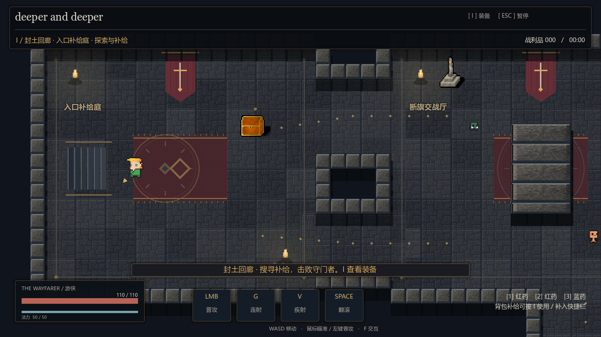
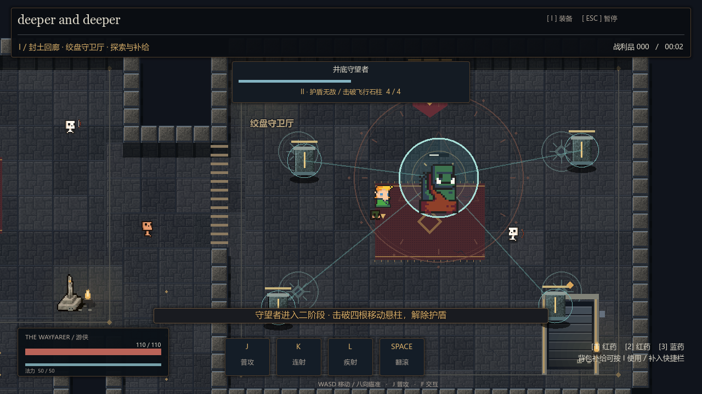
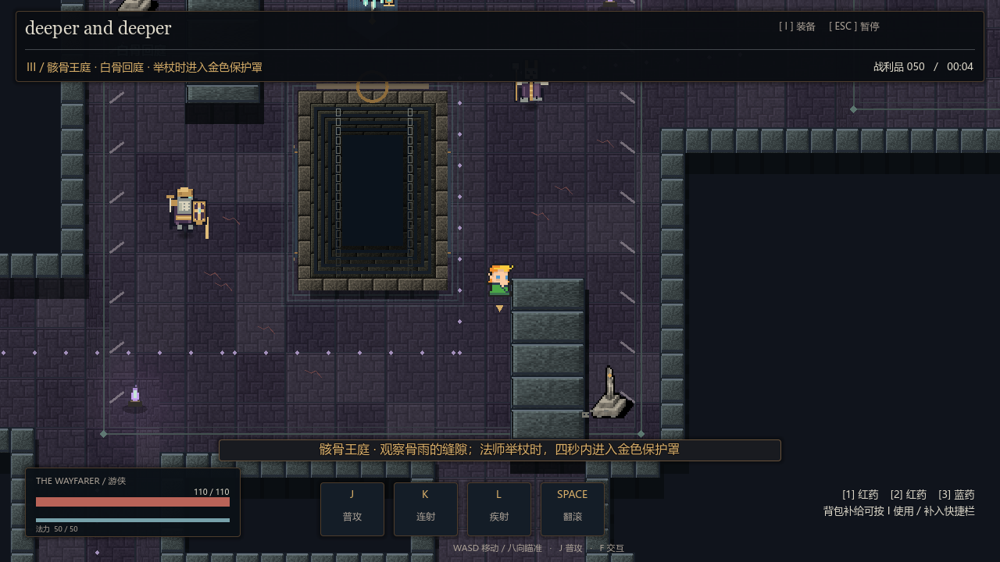
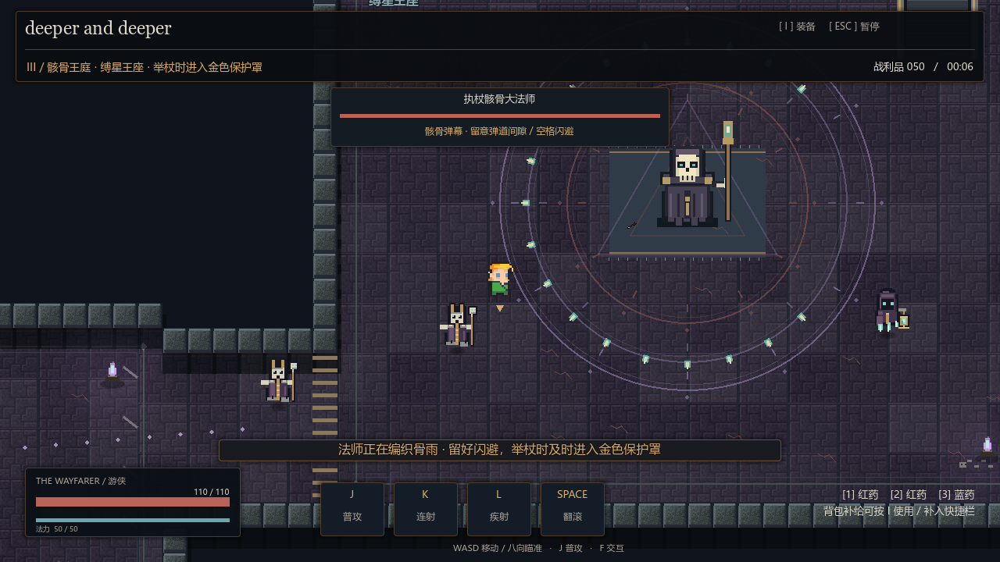
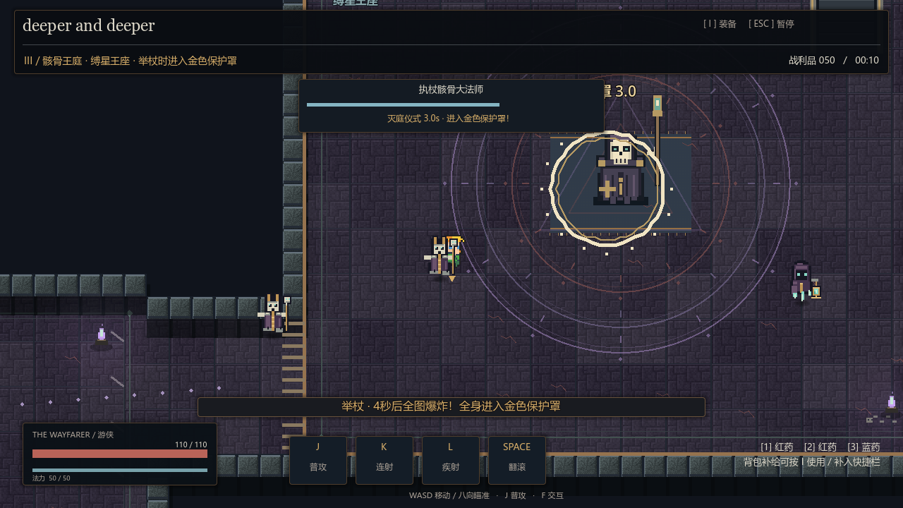

# deeper and deeper · 下潜试玩版0.6.1

## 发给别人玩

完整发送`releases/v0.6.1/deeper-and-deeper-windows-v0.6.1.zip`。Windows 64位电脑完整解压后双击`deeper-and-deeper.exe`，同名PCK必须留在旁边，无需安装Godot。各历史版本统一放在`releases/`，校验值见[版本清单](../releases/manifest.json)。代码仓库不包含ZIP、EXE或模板，源码需自行构建。

源码入口：双击`start-test.cmd`，或Godot4.7.1打开`project.godot`按F5，默认`mvp.tscn`。MVP不读写旧Demo存档。

## 操作

| 操作 | 按键 |
|---|---|
| 移动 / 自由瞄准 | WASD或方向键 / 鼠标位置 |
| 普通射击 | 左键按住连续射击 |
| 一技能 / 二技能 | G连射 / V疾射 |
| 闪避 / 格挡 | 空格 / 右键 |
| 宝箱、升降梯 | F |
| 背包 / 暂停 | I / Esc |
| 快捷药剂 | 1 / 2 / 3 |

角色前方金色箭头跟随鼠标射向，移动与瞄准独立。旧JKL不再绑定战斗；技能面板P、聊天H。格挡减伤同时移速×0.75、射击间隔×1.35；翻滚解除格挡。

## 三层路线

1. 第一层封土回廊：首箱选择弓后在I面板装备；双入口绕中央掩体，补给侧室可绕侧翼。现有四柱守望者在本层：半血无敌转场，击破四根移动悬柱后完成二阶段。击败后可撤离、普通下潜或井契下潜。
2. 第二层无灯圣所：上路远程交火、下路冲锋补给，井缘汇合；击败墓门执刑者后选择撤离或进入第三层。井契仅在第一层选择，第二层额外两处裂隙。
3. 第三层骸骨王庭：白骨回庭围绕实体井分路，可选骨库；铜誓盾卫正面减伤，缚骨祭司锁向三路骨针，提灯幽魂蓄力六向慢弹。
4. 最终执杖骸骨大法师：旋转骨雨留开口，骨莲种子延迟二次绽放成花瓣弹幕，并预告召唤小骷髅（最多四只）。利用空格闪避与弹道间隙穿行。
5. 每打掉1/3生命（剩余2/3、1/3各一次）触发举杖仪式：本体无敌，旧弹幕和召唤清理，生成金色保护罩。四秒内让角色全身进入罩内；罩外全图爆炸无法用格挡/无敌帧硬吃。结束后有两秒输出窗口。

受击的怪物保留仇恨，普通怪能追出原房间与初始察觉范围；Boss被箭击中也警觉，但玩家必须进战场才能伤害本体，入场后锁门。

## 本局系统

六装备、首箱两弓选择、取消/满包/领取去重保留。普通怪掉装保底跨层延续、新局清零；红药35%最大生命，蓝药40%最大法力。撤离×1、最终普通通关×2、井契通关×2.5，死亡0。召唤小骷髅与悬柱不计普通掉落/分数。无中途存档、永久成长或跨局仓库，最佳分仅本次启动。

## 音乐

平时为原创中世纪器乐，Boss警觉后淡入激昂电子曲；切换1秒，暂停/整理背包会降低音量。Esc暂停菜单可开关背景音乐。

0.6.1修复：角色不再继承另一角色的平台速度；守望者独立受击区覆盖可见身体并处理贴身初生箭。证据见[PATCH_061_REPORT.md](PATCH_061_REPORT.md)。

## 开发检查

`tools/check_game.ps1`为统一回归；`tools/check_export.ps1`检查PCK；`tools/build_windows.ps1`用官方模板生成版本ZIP并更新SHA256清单。关卡见[LEVEL_DESIGN_06.md](LEVEL_DESIGN_06.md)，证据见[PLAYTEST_06_REPORT.md](PLAYTEST_06_REPORT.md)。真人手感、难度、长局稳定性及新机器仍待验收。

0.6.1最终14组回归、PCK与独立ZIP本机原生运行通过，朋友手感与实际场景复测待反馈。

## 实机预览

