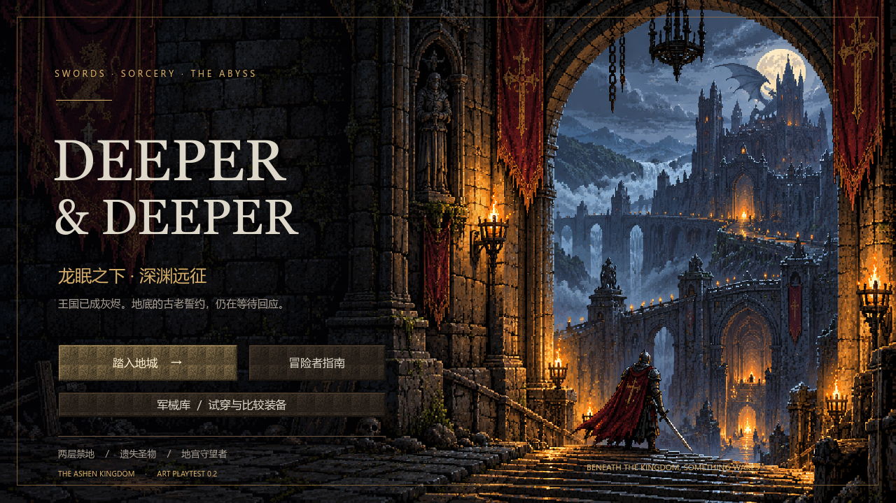
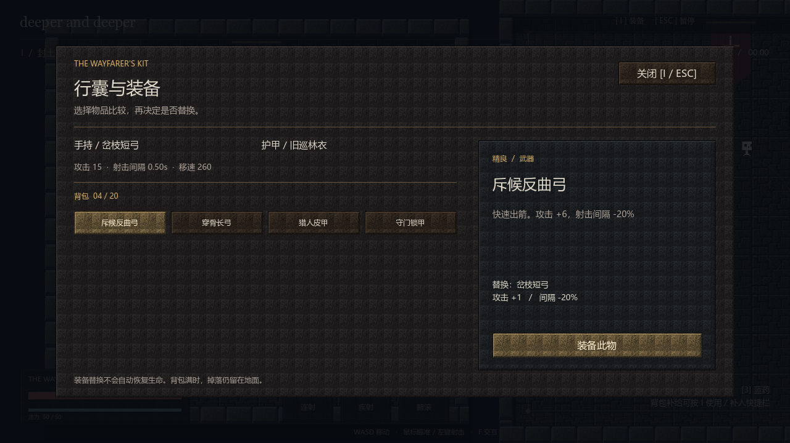
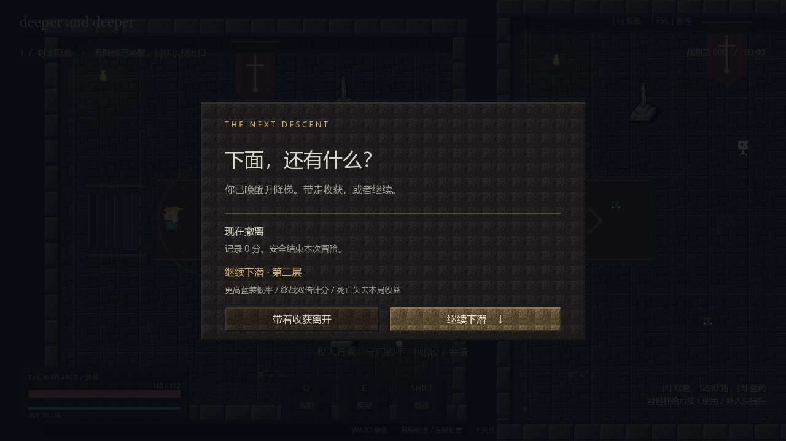
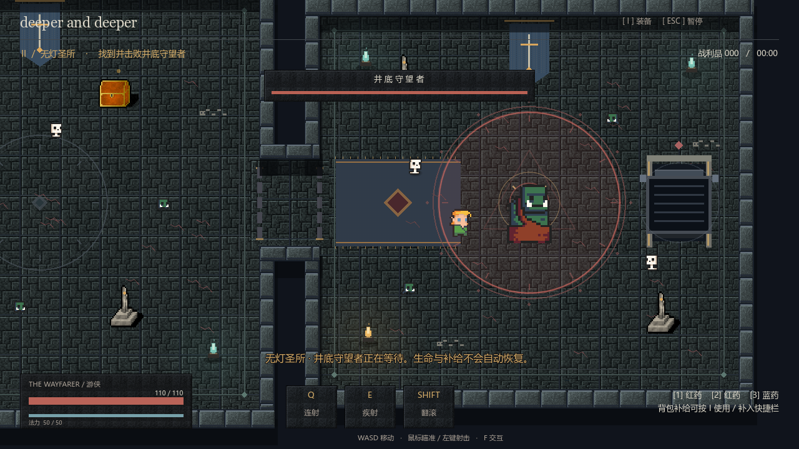

# deeper and deeper · 美术与方向测试版 0.1

## 启动

项目根目录双击 `start-test.cmd`，或用Godot 4.7打开project.godot按F5。默认场景为mvp.tscn；旧main.tscn仍保留，MVP不读取或覆盖旧存档。

```powershell
.\start-test.ps1
# 引擎不在默认目录时：
.\start-test.ps1 -GodotPath 'C:\Godot\Godot.exe'
# 显卡驱动不支持默认模式时可尝试：
.\start-test.ps1 -Compatibility
```

启动器优先查GODOT_BIN、PATH和本机D:\Godot目录。这是依赖Godot的项目测试版，不是已导出的独立exe；首次克隆应先用编辑器导入资源。

## 评审路线

1. 观察标题的层叠字、竖井构图与骨白/烛金/墨蓝配色。
2. 点“装备试配”，直接比较四件候选和身上的两件起步装备；选物品后点“装备此物”。
3. 正常冒险从第一间安全房开始，靠近右上补给匣按F，按I比较并装备反曲弓。
4. 沿门洞向右，观察普通敌人的扇形蓄力，翻滚离开红色危险区。
5. 击败第三间房的守门精英，到右侧升降梯按F，选择撤离或继续下潜。
6. 第二层保留装备、生命和补给；Boss交替使用圆形重击与直线冲刺。胜利/死亡后可重开。

## 操作

| 操作 | 按键 |
|---|---|
| 移动 | WASD / 方向键 |
| 瞄准 / 射击 | 鼠标 / 左键 |
| 格挡 / 翻滚 | 右键 / Shift |
| 连射 / 疾射 | Q / E |
| 搜寻 / 出口 | F |
| 装备 / 补给 | I |
| 快捷药剂 | 1 / 2 / 3 |
| 暂停 / 关闭面板 | Esc |

## 实际范围与边界

- 两层，每层三个相连房间、8个普通敌人与1个精英或Boss，每层2个补给匣。
- 手工配置布局，固定种子生成表面细节；不是完整程序随机关卡。
- 六件装备：岔枝短弓、斥候反曲弓、穿骨长弓、旧巡林衣、猎人皮甲、守门锁甲。
- 起步白装不进随机池；奖励四件为其余绿/蓝装备。普通怪基础10%掉装，8连空后第9次必掉；首个宝箱必得反曲弓，精英必掉装备。
- 第一层绿80%/蓝20%，第二层绿40%/蓝60%，武器/护甲各50%。保底跨层延续，新局清零。
- 击杀普通怪3分、精英25、Boss50，开箱10分；撤离记录原分，通关翻倍，死亡0分。
- 最高分只在本次启动内保留；无中途续玩、永久成长、饰品或18件装备全量接入。
- 红药回复最大生命35%，蓝药回复最大法力40%；背包药剂优先补入空快捷槽，槽满直接使用。
- 没有开发刷怪与无敌界面；AI面板不进入MVP流程。
- 旧Demo保留，但共享Player/ItemData/Arrow，因此基础装备、药水及属性修正也作用于旧场景。

## 美术选择

冷石墨蓝压低环境对比，烛金标记补给与交互，骨白用于结构和文字，深红表示危险。第二层增加冷青火与红色裂纹。保留现有像素角色；地牢结构、灯火与菜单为程序绘制，无新增外部资源或网络依赖。

HUD只保留战斗必要信息，属性比较放在背包；Boss血条接近后出现。当前目的是评审画风、界面、装备差异与下潜动机；8–12分钟目标时长尚需真人试玩和平衡验证。

## 验证

```powershell
.\start-test.ps1 -SmokeTest
& 'D:\Godot\Godot_v4.7.1-stable_win64_console.exe' --headless --path . --script res://tools/test_mvp_equipment.gd
```

流程回归：新局、开箱去重、装备替换、真实精英死亡解锁、换层清理、真实Boss死亡通关、重开复位、玩家死亡结束。装备测试包含真实碰撞：普通箭仅首敌、穿透箭命中两敌、墙阻断，并检查换装不叠加/不回血、移速、防御、MP上限与药水。

已用本机Intel Iris Xe / Godot 4.7.1 D3D12启动并检查实际截图，旧场景启动也已回归。未完成独立exe导出、新机器冷启动、长期性能采样与陌生玩家测试。

## 实机预览






